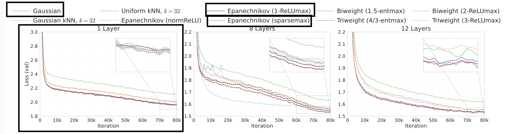
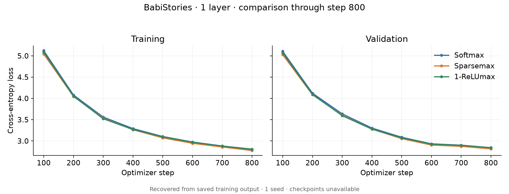
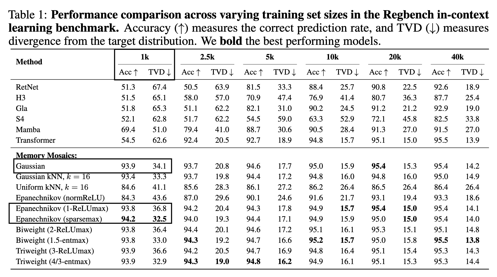
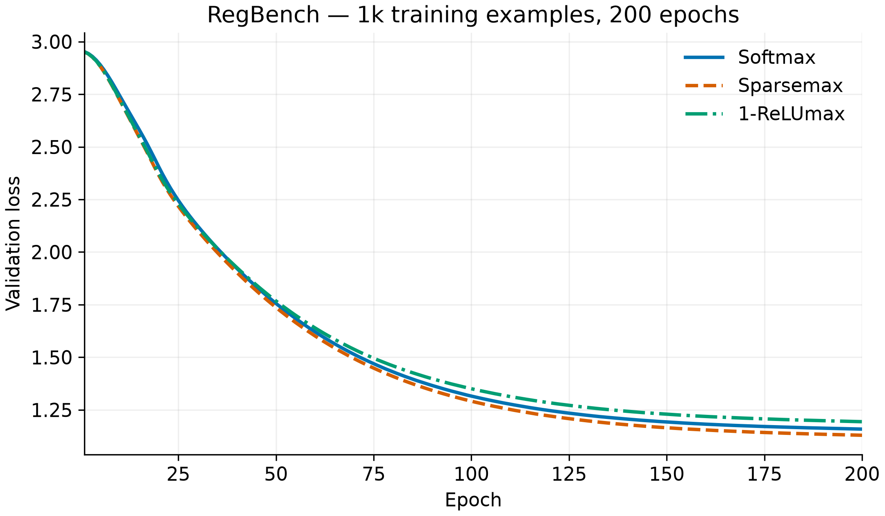

# Отчёт о воспроизведении "Sparse Attention as Compact Kernel Regression"

## Задачи, на которых тестировались предложенные в статье варианты sparse attention через compact-support kernels

|Задача|Краткое описание|Метрики|В репозитории предоставлены данные/процесс генерации данных|
|---|---|---|---|
|Language modeling|Используется синтетический датасет Babi stories (предложен в статье Memory Mosaics). Готовые данные доступны как архив в оригинальном репозитории Memory Mosaics. Задача — next-token prediction.|next-token prediction validation loss|Да
|In-context learning|Используется бенчмарк RegBench. Задача - по последовательности строк, сгенерированных одним вероятностным конечным автоматом предсказать следующий токен (test time).|Accuracy, TVD (total variation distance)|Да
|Length generalization|На случайных последовательностях чисел решаются задачи, связанные с восстановлением информации из последовательности. Три задачи: Multi-query multi-token associative recall (модификация associative recall, в модель подаются последовательность пар ключ-значение, значение может состоять из нескольких токенов, затем последовательность запросов, модель должна вернуть соответствующие запросу значения), sequence sorting (сортировка входной последовательности чисел), reverse (вернуть входную последовательность в обратном порядке)|Accuracy|Нет

## Ресурсы, использованные авторами

Авторы использовали H100 и H200 для задач language modeling, A6000 для задачи in-context learning, A6000 для задачи Length generalization. 

Воспроизведение проводилось на двух видеокартах Nvidia T4.

## Встретившиеся сложности

- В опубликованном `Library` отсутствовали необходимые для запуска `utils.py` и `setup.py`. Добавлены из оригинального Memory Mosaics вместе с лицензией; в `utils.py` добавлен недостающий `import argparse`.
- В `Library/train_memory_mosaics.py` импортируется отсутствующий модуль `common_metrics_epoch1`. Импорт заменён на существующий `memory_mosaics.evaluation.common_metrics`.
- В том же скрипте `distributed.barrier()` вызывается без проверки DDP, что мешает запуску без распределённой инициализации. Добавлена проверка `if ddp`.
- При gradient accumulation батч читается до цикла microsteps и используется повторно: накопление не увеличивает число обработанных примеров до заявленного глобального batch. Чтение нового батча перенесено внутрь цикла.
- В `sparse_kernel_regression/Library/memory_mosaics/models/memory_mosaics_eft.py`, в реализации ReLUmax, для маски используется значение `-1e12`, не представимое в FP16. Для совместимости с FP16 оно заменено на `torch.finfo(scores.dtype).min`.

## Параметры воспроизведения

Из-за ограничений в вычислительных ресурсах, полная сетка экспериментов не повторялась. Было выбрано три механизма attention: softmax (гауссово ядро, baseline), sparsemax (ядро Епанечникова с адаптивной нормировкой) и 1-ReLUmax (вариант ядра Епанечникова с привязкой к максимальному score, предложенный авторами) Такой набор позволяет сравнить стандартный attention, вариант наиболее успешного в целом семейства sparsemax/α-entmax и новый механизм статьи.

Sparsemax оптимизирован в коде с помощью triton кернелов из более ранней работы авторов. Softmax и 1-ReLUmax -- написаны на обычном torch. 

## Воспроизведение
### **Language modeling**
В статье проводились эксперименты со следующими гиперпараметрами

- Согласно проведенным замерам, обучение однослойной модели на 80k шагов на всем датасете (2 Nvidia T4) займет ~99 часов
- Мы ограничимся только однослойным вариантом архитектуры и 1000 шагов.
- Проверяем, сохраняют ли разреженные варианты внимания сопоставимое качество в однослойной модели

Результаты авторов (в рамку обведено то, что мы тестируем)


Авторы отмечают преимущество sparsemax и entmax над стандартным softmax при 1 и 8 слоях; при 12 слоях результаты большинства методов близки. ReLUmax немного уступает sparsemax и entmax, но превосходит normReLU.

Наш результат (1-ReLUmax был обучен максимум до 800 шагов -- поэтому сравнение на 800 шагах)

| Method | Step | Train loss | Validation loss |
|---|---:|---:|---:|
| Softmax | 800 | 2.8071 | 2.8421 |
| Sparsemax | 800 | 2.7749 | 2.8131 |
| 1-ReLUmax | 800 | 2.7997 | 2.8400 |



**Вывод**:
- Полученные результаты качественно согласуются с выводами авторов
- Для более надежной оценки следует запустить более длительное обучение
### **In-Context Learning**

Авторы подбирали гиперпараметры по сетке. В репозитории выложены подобранные. Это 
```model.n_layer=2 model.method=softmax model.n_embd=128 model.n_head=8 optimizer.lr=1e-4 optimizer.weight_decay=0.01```
Результаты обучения memory mosaics на RegBench представлены ниже (1k, 2.5k, etc. означают кол-во обучающих примеров; был воспроизведен только 1k вследствие ограниченности ресурсов). Эксперименты, которые были воспроизведены, отмечены прямоугольниками. 


Полученные при воспроизведении результаты (использовалась опубликованная конфигурация авторов)
| Method | Train s/epoch | Validation s/epoch | 200 epochs, h | Test accuracy | Test TVD | Last-token accuracy | Last-token TVD |
|---|---:|---:|---:|---:|---:|---:|---:|
| softmax | 9.00 | 3.73 | 0.89 | 93.39% | 34.31% | 98.00% | 29.63% |
| epanechnikov | 11.69 | 6.05 | 1.17 | **93.62%** | **33.26%** | 98.00% | 27.84% |
| relumax | 12.01 | 4.64 | 1.11 | 93.49% | 36.87% | 98.20% | 32.65% |

Результаты воспроизведения:


В тексте статьи указано, что авторы считали точность на последнем токене. Однако, в коде репозитория `sparse_kernel_regression/ICLL/plot_ICL.py` считается точность по всей последовательности. В `run_icl_probe.py` был добавлен расчёт метрик для последнего токена. Однако, метрики по всем токенам значительно ближе к тем, что в статье.

**Вывод**:
- Результаты авторов подтвердились -- разреженное внимание лучше справляется с задачей в данном случае
- Лучший результат -- у адаптивного ядра Епанечникова
### **Length Generalization**

Эксперименты на length generalization не включены в итоговое воспроизведение. В опубликованном репозитории отсутствуют данные и код их генерации, а описание постановки не позволяет однозначно восстановить распределение входных последовательностей. Использование генератора из другой работы добавило бы неопределённость при сопоставлении результатов со статьёй.

**Вывод**:
- Эксперимент Length generalization не включён в воспроизведение

**Итог**:
- Выводы авторов подтверждаются проведенными экспериментами
- В проведённых экспериментах sparsemax показал немного лучшие значения validation loss в Language Modeling и accuracy/TVD в In-context learning на RegBench

### Запуск экспериментов.

Инструкция в README.md